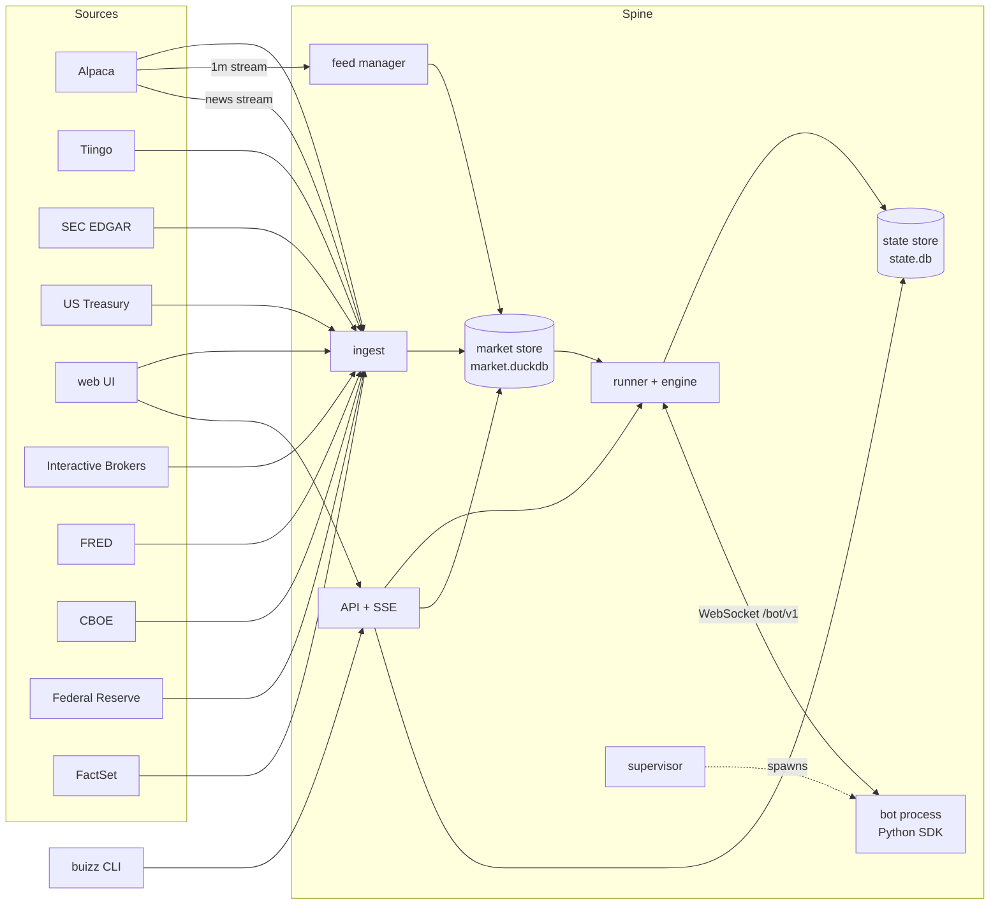

# Architecture

Buizz is one Rust binary, the spine, plus Python bots that dial into it and a web UI the spine serves. The spine owns the clock, order matching, fills and the ledger of every run. Bots only decide.

## Components

| Component | Crate or folder | Job |
|---|---|---|
| Spine | `crates/spine` | The binary: reads the environment, wires everything, serves HTTP, shuts down cleanly on SIGTERM or Ctrl-C (closing event streams, then stopping runs at their last checkpoint); a second signal exits at once. `buizz-spine restore <backup>` loads a market backup into an empty store instead (see Restoring) |
| Core | `crates/core` | Types and rules shared by all: run config, cost model, risk limits, order and ledger types, visibility rules, bot protocol messages, API types |
| Market store | `crates/market` | Embedded DuckDB (`market.duckdb`): instruments, companies (SIC codes), calendar, daily and 1m bars, corporate actions, fundamentals, earnings releases, insider transactions (Forms 4 and 4/A), the news archive, index membership, borrow availability, rates, macro series, the FOMC calendar, FactSet Earnings Insight reports and the figures read from them, coverage. All reads a run does are as-of queries here. The schema is versioned in `schema_version`: a fresh file gets `schema.sql`, an older one the numbered migrations in `crates/market/migrations/` it has not seen (version 1 is the first deployed schema, kept in `tests/fixtures/schema_v1.sql`), applied in one transaction on open; a file from a newer spine is refused |
| State store | `crates/state` | SQLite in WAL mode (`state.db`): runs, orders, ledger, equity points, run events, job runs, fetch records, step checkpoints. Opening an older file applies the numbered migrations in `crates/state/migrations/` it has not seen |
| Engine | `crates/engine` | Pure, deterministic order matching and portfolio ledger. Takes a bar cycle and the bot's orders, returns fills, ledger entries, equity points and risk breaches. A drawdown breach cancels the working orders and closes every position at the following opens |
| Runner | `crates/runner` | Drives runs: replays bars in lockstep with the bot, calls the engine, commits each step and its checkpoint to the state store, recomputes a live run's stats into `run.live_stats` after each session close it commits and whenever the daily bars advance (the benchmark's close for a session arrives with them) and pushes them, with the envelope of its source backtest (the backtest it went live from, recorded as `run.source_run`; for a live run without one, the most recent of the longest completed pre-holdout backtests of the same bot hash, params, costs and risk limits; read fresh from its session-close equity each time, so a newer backtest is picked up and nothing else is cached), applies the data gate and holdout rule, queues sweeps, judges the screening gate, recovers runs after a restart |
| Supervisor | `crates/supervisor` | Scans `bots/`, starts bot child processes (own process group, killed as a group), captures their output, reaps them with their wall time and peak memory, and holds the backtest and live start-up slots and the crash backoff (1, 2, 4, 8 and 16 s, a live run pauses after 5 crashes in 10 minutes) |
| Feed manager | `crates/feed` | Holds the Alpaca real-time stream subscriptions for live 1m runs. Ref-counted, capped at 30 symbols, refuses over the cap naming the holders, backfills gaps and the session so far for newly subscribed symbols, and writes bars to the market store |
| Ingest | `crates/ingest` | Scheduled jobs that fill the market store (see below), the news recorder, a lazy 1m backfill for minute backtests, a daily `state.db` snapshot |
| Sources | `crates/sources` | Clients for Alpaca (REST and stream), Tiingo, SEC EDGAR, US Treasury, FRED, CBOE, the Federal Reserve Board, Wikipedia, NASDAQ Trader's symbol directory, and the Interactive Brokers short stock file and FactSet's Earnings Insight (, with the PDF reader and the parser of its figures), with rate limits and backoff |
| API | `crates/api` | Axum routes under `/api` for bots, runs (a run's events filter by `kind`; `/api/runs/{id}/chart/{symbol}` gives one symbol's bars over the run's period in its timeframe, as of the run's clock and adjusted only for the splits visible by then, so the latest bars are raw prices and match the positions; each fill carries the price it traded at and its `chart_price` on the same adjustment, with the order's reason, plus the splits and the open position's average cost; bars come 5000 at a time, older ones with `before`, newer ones with `after`, which the web asks for whenever the run's equity or fills move on the event stream), bots (`GET /api/bots` gives each bot's default params, its stage, draft, screened (a variant of its current code passes the screening gate) or live, the screening summary and its active live runs found directly, never from a window of recent runs; `POST /api/bots/{name}/live` with an optional `from_run` starts a live variant, `POST /api/bots/{name}/sweeps` queues a grid, `POST /api/bots/{name}/backtests/cancel` cancels its queued backtests, `GET /api/periods` gives each preset's dates today and whether the data floor shortened it, `GET /api/bots/{name}/research` gives the variants per preset with the gate, neighbourhood medians, plateau, SPY and luck line; a live run pauses, resumes and cancels, with an optional reason that retires it, under `/api/runs/{id}`), the league (`GET /api/league`: every live run ever started, ranked by the probabilistic Sharpe of daily excess return over the benchmark once it has 20 sessions, younger ones in a "too early" group, with M = live runs started and the sessions each still needs) and data health, server-sent events for live updates (a live run's equity on every step, a backtest's at most every 250 ms plus its final value, every run status with its mode, and a `live_session` summary after each live session close), the bot WebSocket at `/bot/v1` (peers on loopback or the spine's bound address only), an unauthenticated `GET /healthz` (204) for probes, and the web bundle when `BUIZZ_WEB_DIR` is set; unknown `/api` paths answer a JSON 404. One admin passlogin (`BUIZZ_ADMIN_USERNAME`, default `admin`, and `BUIZZ_ADMIN_PASSWORD`, both compared in constant time and refused wordith one message), an HttpOnly session cookie, failed logins rate-limited per client (an IPv4 address or an IPv6 /64) with a global failure budget that, once spent, paces password checks to one per second, and requests other than reads refused unless a browser sends them from the same origin. Every response carries a same-origin-only Content-Security-Policy that also forbids framing, `nosniff` and a same-origin referrer policy |
| Metrics | `crates/metrics` | The benchmark as a total-return buy and hold of its symbol from the run's start cash at the close before the first session, on raw prices: a split multiplies the shares on its ex-date and a cash dividend is reinvested at the ex-date's open, as the engine credits it to a holder; every comparison with the benchmark below uses it. CAGR, volatility, Sharpe, Sortino, drawdown, Calmar, win rate, profit factor, exposure, turnover, alpha and beta from the equity series; live stats against the benchmark over the same sessions (CAGR, return and their excess with standard errors, drawdown, volatility, beta), the probabilistic Sharpe of daily excess return and the minimum track record length (Bailey and López de Prado); the envelope of a live run aged N sessions from its source backtest (the 5th percentile of excess return over the benchmark across every rolling N-session window, the 95th percentile of within-window max drawdown, the annualized volatility of daily returns) and the verdict: incubating under 20 sessions, then falsified when the excess falls below that band, the drawdown goes deeper or the volatility exceeds 1.5× the backtest's (recorded with the failed tests; flagged, never stopped), proven when the probabilistic Sharpe reaches 1 − 0.05 ÷ live runs started (re-judged on every read, since that count grows), no backtest without a source, otherwise tracking |
| Web | `web/` | React and TypeScript with lightweight-charts: bots (a pipeline of stage counts, the best live and best screened bot against total-return SPY, then one list with a row per bot or live variant and its single most relevant number; `/api/bots` gives each its plateau variant, else default params, else latest variant among the standard runs on the gate's period, with its metrics, total-return SPY's and a 60-point curve against it), league, bot detail split into Runs (`#/bots/<name>`, the run view) and Research (`#/bots/<name>/research[/<preset>]`: per preset the spread of Sharpe across variants with median, middle half, gate passes, SPY and the luck line, the best result only beside its neighbourhood median, the plateau variant to go live with, a heatmap when one or two params vary, the sortable variants table, the sweep dialog and every run), run view, data health; each page patches what a pushed event changed in place and refetches at most the one bot whose live runs or stage changed. A symbol in a run's trades, orders or positions links to `#/bots/<bot>/runs/<id>/symbol/<SYM>`, the run's overview with that symbol's candles, volume, fills and average entry under the equity curve; the two charts share crosshair and visible range. A live run's verdict pill opens its envelope tests with the band values, falsified runs sort first among the live bots, and a live run's equity chart draws the envelope floor (the benchmark plus the 5th-percentile excess for the run's age at each point), toggled from the legend. Types are generated from `openapi.json`. Design tokens (colour, spacing, radius, type, elevation, motion) and shared primitives live in `web/src/styles/{tokens,base,components}.css`; each area imports its own stylesheet (`shell`, `bots`, `board`, `bot-detail`, `chart`, `data`). Pages fill the window width inside a `--gutter` margin; the page is a size container, so on wide screens the run overview sets the metrics beside its charts and the data page flows its panels into two to four columns, while tables keep their own scroll and sticky first column. The light, dark or system theme is a per-browser choice kept in local storage, as is each table's sort column (`web/src/ui/Table.tsx` sorts by header click, nulls last, flashes rows a pushed event changed and shows wall-clock times as "2 min ago" with the exact time on hover); text filters sit in the URL query instead. The small component set is `web/src/ui/Kit.tsx` (Card, Stat, EmptyState), `OverflowMenu` in `web/src/ui/Menu.tsx` and the `Sparkline` mini chart; row selection and the bulk bar live in `web/src/ui/Selection.tsx`, the command palette and shortcuts in `web/src/pages/Commands.tsx`, and the backtest and sweep dialogs open from anywhere through `web/src/pages/Launch.tsx`. The compare view (`#/compare/<ids>`) reads each run's summary and equity and patches them from pushed equity and status events. Every page but Bots loads as its own chunk. Orders, events and runs load in pages, so their sort and text filter cover only the rows loaded so far, and the table says so |
| SDK | `sdk/python` | The `buizz` package: `Bot`, `Context`, the protocol client and the `buizz` command |
| Bots environment | `bots/pyproject.toml` | The locked Python environment bots run in (SDK, hmmlearn, lightgbm, scikit-learn, scipy) and the shared package `buizz_bots` |

`just gen` regenerates the golden protocol frames in `fixtures/protocol/`, `openapi.json` and `web/src/api/schema.d.ts` from the Rust types; `just drift` (part of `just check`) fails when they differ.

## One event path

The engine only ever reads the market store. Ingest and the feed manager write bars and advance a watermark; a run replays bars up to what the store holds. A backtest is a replay that finds all its bars already there. A live run is the same replay loop blocked at the watermark: it waits until the next bar arrives and then goes on. There is no separate live code path for decisions, so backtest and live behave the same by construction, and recovering after a restart is resuming from the last checkpoint.

For each bar the runner runs one cycle: order expiry, corporate actions (a split or stock dividend rescales the position and its working orders, paying the fraction in cash; a cash dividend is credited; a spin-off credits the new company's shares, whole shares with the fraction paid at its ex-date open, and moves that value of cost basis to them; a cash merger closes the position at the deal's cash, a stock merger exchanges it for the acquirer's shares plus any cash, a name change exchanges it one for one for the new ticker's shares, and a worthless removal writes it off at zero, each cancelling the working orders in the old ticker; the delivered company is followed from that session), fills (the opening auction at the session's first bar, then market, limit and stop orders at the bar's open or where the bar touches them, then the closing auction at the session's last bar, both at the official prices of the session's daily bar), then at the bar's visible time mark to market, borrow and financing charges at the session close, risk limits, wake the bot, accept its orders. A bar's cycle finishes before the next bar's begins. A session's corporate actions, universe, average daily volumes and financing rate are read when the run enters it: a backtest reads the next session's ahead while it replays the current one, a live run only when it processes the session's first bar, so nothing announced or ingested after it went live is missed. The run follows the universe plus every symbol it holds or has an order in: an order for any other listed symbol is sized at that symbol's last price visible at the clock, read only then, and the symbol is followed from the next bar, so a hedge outside the universe never loads the whole market. A daily run that wakes before the close gets one more point per session at that time: expiry and corporate actions, a mark at the minute bars so far, the bot's step; the session is then matched in its cycle at the close. Each step is committed together with the engine checkpoint, and so is every bar a live run processes between wakes; the bars and events still waiting for the bot's next step are saved with the checkpoint, so after a restart the clock and equity are where they were and the next step still delivers them.

Live runs on 1m bars use the real-time IEX stream; backtests use SIP history, so volume is partial live. A live 1m run leases stream slots for its session's universe plus the symbols it holds or has orders in, again at every new session and after every step; going live or resuming is refused when the slots are not free, a paused run holds none, and an order for a symbol no free slot can cover is rejected with `no_stream_slot`. Live fills are tagged with the feed. The volume cap uses the average daily volume, so it is the same in both modes. Live runs on daily bars use the official daily bar and take no stream slot, including those that wake before the close: once the wall clock passes their decision point plus 10 seconds (the late-bar grace the stream uses), the run fetches its session's minute bars so far for its universe and holdings over Alpaca REST, exactly as the feed manager backfills a stream gap (SIP up to 15 minutes ago, IEX after that, both multi-symbol requests), stores them in the minute table and then reads them back like any other run, so the bars the bot sees are the stored rows a backtest reads. Runs deciding at the same time share the fetch: a symbol already fetched through that decision point today is not asked again. A failed fetch is logged on the run and retried after 1 s, doubling to a minute, while the decision waits for it; after the tenth failure (about five minutes) the run logs a warning and skips that session's before-close step, so the bot does not decide that day and the session is matched at its close as usual. An order for a symbol the run does not follow is priced the same way: its minute bars so far are fetched over REST before the order is sized, and a failed fetch is logged and prices it at its last daily close. Going live or resuming such a run only needs the Alpaca key.

The feed manager runs one websocket per stream account. `ALPACA_STREAM_KEYS` lists the accounts, one `key_id:secret` per line; unset, the ingest key (`ALPACA_KEY_ID`) is the one account. Each account streams at most 30 symbols, so the cap is 30 × accounts. Leases are counted per symbol across runs; a newly leased symbol goes on the open connection with the most free room and stays there until no run holds it, so a symbol never moves between connections and never misses a minute. A dropped connection reconnects (1 s doubling to a minute) and backfills only its own symbols. A connection whose key Alpaca refuses is closed for good: its symbols move to the others when they have room, and its slots no longer count as free. Each connection settles its minutes on its own; the minute watermark is the slowest connection that streams any symbol, and it holds while any of them backfills or while a leased symbol has no open connection with room (after an account fails), so a live run never treats a minute as final before every bar it follows is in. A backfill keeps any streamed bar its REST answer lacks. The data health page shows the slots in use and each connection's usage, state and last error. Keys are never logged, shown or exposed through the API; a malformed line of `ALPACA_STREAM_KEYS` is reported by line number only.
**Variants, sweeps and the screening gate.** A run's variant is its merged params (`run.variant`, a column generated from the config); a requested value is coerced to the type of the bot's default, so `2` and `2.0` are one variant, and a value that cannot be is refused. A bot has at most one active live run per variant and at most three live variants. A sweep is the cartesian product of a grid (at most 256 variants) on one pre-holdout preset with default costs and one seed: the coverage gate is checked once, variants already queued, running or completed on the same code and period with default costs, the bot's risk limits and the default start cash are skipped, and the rest are created queued in one transaction and run by the backtest queue. A preset (1, 3, 5 or 10 years) ends the day before the holdout and starts that many years earlier, but never before 2016-01-04, the first session of Alpaca's daily history, the most any listing can have from the primary source; a preset the floor cuts short says so where it is chosen (`GET /api/periods` gives each preset's dates today), and the history before it (Tiingo's pre-2016 years) stays available to a bot's lookback. A backtest belongs to a preset when its period is that preset resolved on the day it was created and it ran with default costs, the bot's risk limits and the default start cash, so a backtest with a drawdown stop or other cash of its own never stands in for a variant. The gate is judged on the longest preset with a finished variant of the current code: completed, no data warnings (an index run whose only warnings are member gaps covering at most 0.5% of its member-sessions carries `minor_data_gaps` instead, which passes, unless the bot ordered or held one of those members during its gap, which turns it into `data_warnings` when the run completes; the warnings stay on the run) or drawdown stop, at least 10 round trips, Sharpe above 0, and against the total-return benchmark over the same period at matched volatility: the variant's daily returns above the T-bill rate are scaled by the benchmark's realised volatility over its own (the rest earning the T-bill rate, leverage above 1× charged T-bill plus the run's financing spread), and that series must beat the benchmark's CAGR, draw down no deeper, and end ahead of it in at least 2 of the period's 3 equal thirds. Trials are counted over all of a bot's runs as distinct (code hash, variant), where two code hashes of a variant are one trial once they gave the same result hash on the same period (a rerun that reproduced an earlier result exactly), and a code change that alters the result is a new trial; the luck line is σ·√(2 ln N) with σ ≈ √(252 / sessions). The neighbourhood of a variant is the variants one grid step away on every swept param; the plateau is the passing variant with the best neighbourhood median Sharpe.

When bars arrive in live while the bot is still deciding, they coalesce into its next step. Pausing a live run cancels its working orders and stops the bot process while the spine keeps marking equity; resuming starts the bot again with its saved state and current holdings and never replays the paused interval.

**Process model.** A backtest's bot process lives for the whole backtest, and backtests run in parallel up to one fewer than the CPUs the spine sees (at least one). A live run's bot process lives for one session: the runner starts it at the session's first wake, and after the step of the session's last wake it sends `end` with reason `session_end` and the process exits; working orders stay in the engine and keep filling, and the bars that arrive until the next wake wait in the checkpoint for that wake's step. A daily bot is a process for a few seconds a day, a 1m bot from the open to the close, and a session in which the bot never wakes starts no process. Each new process gets `ready` with the saved `ctx.state` and the current holdings, as after a restart. Start-ups go through the live slots (`BUIZZ_LIVE_SLOTS`, default 2): a live process takes a slot before it starts and gives it back once it has answered its first step, so at the close of a day with many daily bots they start, decide and exit a few at a time. A bot that crashes mid-session is started again at its next wake after the backoff; a spine restart mid-session starts it at the next wake too. Every reaped bot process adds its wall time and peak resident memory (`ru_maxrss`, which includes the Python interpreter `uv` waits on) to its run; the run page shows them and the Data page lists them per bot and mode next to the slot counts, so the limits below can be set from measurements.

## Guarantees

**No lookahead.** Every query a bot makes is answered by the spine as of the run clock; the bot has no direct access to data. The visibility rules live in `crates/core` and are the single source of truth: a 1m bar is visible at its start plus 60 seconds, a daily bar at the session close, a fundamental fact at the open of the first session after its SEC `filed` date, an insider transaction at the open of the first session after its Form 4's EDGAR acceptance time, a news article version when the spine received it (or, for history fetched later, at its `updated_at`), a corporate action at the open of its ex-date session (a merger's effective date, a worthless removal's or name change's processing date), a calendar change at the open of the first session after its announcement, a macro observation (a FRED vintage, a Treasury rate, a VIX close) at the open of the first session after its publication date, a scheduled FOMC meeting from the start of its year and an unscheduled FOMC action at the open of the first session after its release, a figure from FactSet's Earnings Insight at the open of the first session after the report's publication date. History adjustment uses only corporate actions already visible at the clock: splits and stock dividends rescale price and volume in both `split` and `all`; `all` also takes out each ex-date's cash dividends and spin-offs as one factor, 1 − (dividends + the delivered shares at the new company's ex-date open) ÷ the previous close, the spin-off's part only once that first bar is visible at its session close. A symbol is a ticker as of the clock: it names the company that traded under it on that date. Alpaca stores a company's whole history under its current ticker, so the store resolves a ticker on a date through the name changes it holds (a when-issued, unit or warrant line turning into the regular shares is not one): an earlier ticker resolves to the company's current one (FB before 2022-06-09 is the listing stored as META), a ticker a company only took later names nobody before then (META in March 2022), and a listing that ended before another company took its ticker is stored under its own key, the ticker and its last session (`STI@2019-12-06`, SunTrust); a rename away from a ticker follows only the company that held it then, so XL Fleet's rename to SPRU in 2022 does not make XL Group's 2016 sessions SPRU's, and a ticker a company renamed or merged away from before another renamed into it still names the earlier company until then (XL Group's XL before 2020, Paramount's PARA before 2026). An index member also reaches back through a one-for-one stock merger with no cash into a company formed by it (no bars of its own more than 30 days before the merger): S&P's SKYD was PSKY, which Paramount (PARA) merged into on 2025-08-07, and VTRS was Mylan (MYL). `corporate_actions` reads every stock merger market-wide from the history start on each run for this. History asked for at the clock is that listing's, back through its earlier tickers; the bars a run trades on are resolved per session, and its universe, corporate actions, average volumes, instrument details, fundamentals, earnings and insider trades follow the same resolution, so an S&P 500 member reads FB before its rename and META after. A merger or worthless removal ends the listing under its ticker, and so does a name change unless a company renames into that ticker later (Roundhill's fund leaving META in January 2022 does not cut Facebook's history): history asked for after it starts at its date, so a company that later takes the ticker never inherits the earlier one's bars. An order decided on bar N cannot fill before bar N+1's open. `fixtures/scenarios/` holds hand-computed expectations, including a lookahead probe. When a bot asks for a macro series none of which was published before the clock, or for a fundamental metric none of the asked symbols has filed by then, the run records a data warning, once per series or metric, so an empty answer is never silent.

**Determinism.** The engine uses no wall clock and no unseeded randomness, keeps ordered maps and chains a blake3 hash over every ledger entry and order change. A completed run stores it as `result_hash`: the same bot, config, seed and data give the same hash. Money is `rust_decimal` in the ledger and strings on the wire. Every cash amount enters the ledger rounded half-even to exactly 2 decimals and every price to exactly 4, so `100000` and `100000.00` start cash give the same hash, and a start cash with more than 2 decimals is refused; bars reach bots as float columns, and floats never enter the ledger. All times are UTC.

**Wall clock.** Outside the engine, everything that needs the current time (ingest schedules, the feed's backfills and SIP delay, live run stamps, the API's today) reads `Timestamp::now()` in `crates/core`, the one wall-clock source; only a rate limit's reset, which a provider states in its own real time, reads the system clock. `BUIZZ_CLOCK_OFFSET_SECONDS` shifts that clock: the end-to-end scenarios start every spine at noon New York time with it, so they behave the same at any hour. A New York local time that a daylight saving change repeats resolves to its first occurrence, and one the change skips to the same reading on the clock before the change (02:30 on the spring change is 03:30 EDT).

**Crash safety.** The ledger and checkpoints are written in SQLite transactions, one per step. On start the runner recovers runs that were active.

**Reproducibility.** A run records the bot content hash, engine version, seed, data watermark and its full config. The engine version is a number bumped whenever the engine's behaviour, its checkpoint or the meaning of a run's stored metrics changes (engine 9 exchanges a position for the new ticker's shares on a name change; engine 8 applies stock dividends, spin-offs, mergers and worthless removals to positions). A live run resumes from an older engine's checkpoint; a backtest refuses to, so its result never mixes two engines. A run never continues under different bot code: whenever the runner starts a bot process, each live session's and a crashed bot's restart included, the folder's hash is compared with the run's, failing a backtest and pausing a live run with the reason.

## Data sources and limits

| Source | Used for | Limits |
|---|---|---|
| Alpaca (free plan) | Daily and 1m history since 2016, calendar, assets, corporate actions, real-time IEX minute bars, the Benzinga news feed (REST history since 2015 and the real-time news stream) | 200 calls per minute, used at most 140 (shared by ingest and the feed manager's backfills); one connection per stream endpoint and account, so each stream account holds one bar stream and the ingest key also holds the news stream; SIP history is delayed by the latest 15 minutes while IEX history is current (the free plan's 15-minute rule applies to SIP only, and `feed=iex` serves the session so far); each bar stream is capped at 30 symbols, and free accounts may be added for more (`ALPACA_STREAM_KEYS`); minute bars include extended hours and are filtered to the session |
| Tiingo | Daily history before 2016 | 50 requests an hour, 1000 a day and 500 symbols a month on the free plan, used at most 35, 700 and 350 so a key shared with another project keeps headroom. Its data is only used when it agrees with Alpaca over their overlap; raw closes and split and dividend factors, never adjusted close |
| SEC EDGAR | Point-in-time fundamentals (raw XBRL facts plus canonical metrics), the fund ticker list, SIC codes, earnings releases and insider transactions (Forms 4 and 4/A) from company submissions and each Form 4's XML document | 10 requests per second, used at most 5; contact User-Agent required (`SEC_USER_AGENT`) |
| US Treasury | Risk-free rate for Sharpe, `treasury_3m` for bots | |
| FRED | Macro series for bots, every ALFRED vintage | 120 requests per minute, used at most 80; free API key (`FRED_API_KEY`) |
| CBOE | Daily VIX and VIX3M closes for bots | The free history files `VIX_History.csv` and `VIX3M_History.csv` on `cdn.cboe.com`, one request per second, two a day |
| Federal Reserve Board | The FOMC meeting calendar for bots, from `fomccalendars.htm` and the yearly `fomchistoricalYYYY.htm` pages on federalreserve.gov | One request per second; the calendar page daily, each historical year once |
| Wikipedia | S&P 500 membership history, rebuilt from *List of S&P 500 companies* and *Historical components of the S&P 500* through the MediaWiki API | One request per second with a User-Agent naming the `SEC_USER_AGENT` contact, as Wikimedia's policy asks; configured with SEC EDGAR. Text under CC BY-SA 4.0 |
| NASDAQ Trader | Which listed symbols are ETFs | The public symbol directory `nasdaqtraded.txt`, one download a day |
| FactSet Earnings Insight | The weekly S&P 500 earnings report (since April 2011): forward 12-month P/E with its 5- and 10-year averages, the forward EPS and closing price it was based on, trailing P/E, quarterly and calendar-year earnings and revenue growth, the share of companies beating EPS and revenue estimates, negative and positive EPS guidance, the bottom-up target price and the Buy/Hold/Sell split, plus sector forward P/Es where the text names them | The latest issue through the `www.factset.com/earningsinsight` redirect. Earlier issues are listed from the Internet Archive's index (CDX) of FactSet's own report URLs, which moved through `websitefiles/PDFs/earningsinsight/` (2011–2016) and HubSpot folders on `insight`, `www`, `go` and `advantage.factset.com` (2017 on); each is read from FactSet when it still serves it (every issue since 2017) and otherwise from the Archive's copy of that URL (2011–2016). FactSet at most 20 requests a minute, the Archive's index at most 15 and its copies at most 6; identified with the `SEC_USER_AGENT` contact, configured with SEC EDGAR. The reports are FactSet's copyright: their text and figures are kept privately for research and never republished |
| Interactive Brokers | Short availability per US ticker (borrow fee, rebate, shares available), recorded so that point-in-time borrow history accumulates. Not used by runs yet | The public, unauthenticated file `usa.txt` on `ftp2.interactivebrokers.com` (user `shortstock`, no password), as IBKR's knowledge base describes it; one download a day |

Ingest jobs, with their interval: `calendar` 1d, `instruments` 1d, `index_membership` 1d, `bars_1d` 6h, `corporate_actions` 1d, `sec_index` 6h, `fundamentals` 6h, `filings` 6h, `insider_trades` 6h, `rates` 1d, `borrow` 1d, `macro` 1d, `news` 6h, `vix` 1d, `fomc` 1d, `earnings_insight` 1d, `earnings_insight_archive` 7d, `state_snapshot` 1d, `market_snapshot` 1d, `tiingo_history` 1h. They run in that order, so a first start fills the calendar and instruments, then prices, then fundamentals. A tick every minute starts those that are due, all scheduled from the tick's time so a slow job does not shift the others; one that stopped at its per-run cap with work left (`partial`) runs again on the next tick, one that found nothing new waits its interval (except that on a new start `macro` and `vix` run at once when a series they fetch has never been read, so a series a new build or a newly set key adds does not wait up to a day), one `waiting` for data its source has not published yet (the day's SEC index, a newer short stock file, the last session's Treasury rate, or the calendar and instruments the price jobs need) retries within the hour, and one that failed, or that a previous start of the spine left unfinished (killed, out of memory), retries after 5 minutes, doubling with each further failure up to its interval, so a job that crashes the process does not crash-loop it. Every client spaces its requests to its budget and retries a whole request three times (0.5, 1 and 2 s apart) on a timeout, a connection dropped before or while the body arrives, or a 5xx. A rate limit (HTTP 429) whose `Retry-After` or `X-RateLimit-Reset` is at most a minute away is waited out and retried; a longer one, or the source's cool-down when it names none (Alpaca, FRED, CBOE, the Federal Reserve, Wikipedia and Treasury 1 minute, SEC EDGAR 10 minutes, Tiingo 1 hour), pauses that source's jobs until then, and they are due again the moment it ends. SEC EDGAR answers throttling and a missing User-Agent with 403, so a 403 from it counts as a rate limit too. Other failures are reported as failures. Each job shows in the UI's data health page with its last outcome and whether it is stale. `bars_1d` targets the last session closed more than 30 minutes ago (the 15 minute SIP delay plus a settle margin), fetches each symbol from its own last stored session grouped by that date, up to 1000 symbols per request, storing every 10,000-bar page as it arrives (at most 600 requests per run), and re-requests a session until a day after its close, so late corrections and the final consolidated volumes land and a revision afterwards is a genuine correction. It prices every instrument not traded over the counter, active or not, plus every symbol that was ever an S&P 500 member (Alpaca keeps bars for delisted names it no longer lists as assets), in this order: SPY and the core ETFs, current members, past members, other active symbols, the rest. An active symbol more than 20 sessions behind, or one Alpaca has no bars for, is retried weekly instead; an inactive one is fetched once. A core ETF, S&P 500 member or delivered symbol without any bars whose only answer so far was an empty one inside a request for many symbols is asked for again on its own at the end of the next run, at most 20 a run, before it waits the week (DOW came back empty inside a request for many symbols). The daily watermark advances once the symbols that are current have their target session, whatever happened to the lagging ones. It then looks for S&P 500 member sessions since 2016 whose listing has no bar and asks Alpaca for the member's ticker twice: as traded (`asof=-`, whatever traded under the ticker) and as Alpaca mapped it on the last missing session (`asof` that date, the company that traded under it then, through all its tickers), and when the two never agree, as mapped on the last stored session before the gap (a company that stopped trading before the index removed it, Staples in September 2017). The sessions on which both answers agree are that company's listing under the ticker, which stops at the action that ended it; a listing still stored under the ticker continues it only when the stored bars end where it does (Dow Chemical's last DOW session is not Dow Inc's). When neither agrees anywhere and the ticker trades after the gap, Alpaca's mapping as of its first stored session after the gap gives the company's sessions under its earlier ticker, used for the gap when that mapping holds the stored session itself (Tesoro's TSO years for ANDV, which Alpaca's name changes do not record). They are stored, never over a stored bar, under the company's current ticker when a stored name change continues it (CDAY's bars before it became DAY), under the ticker itself when it still trades as the same company, and otherwise under the ended listing's own key, recorded as an inactive stock with that last session (SunTrust as `STI@2019-12-06`, TECO as `TE@2016-06-30`), so the member resolves to it during its membership. At most 20 members a run, each asked again after 30 days. A request Alpaca refuses as invalid (400 or 422) or whose answer does not decode (a malformed bar) is split in halves until the symbol behind it is found; that symbol is recorded as rejected and skipped for 30 days, and the rest of its request is stored. Minute backfills are stored page by page too, holding back each page's last symbol-day until the next page completes it. `corporate_actions` stores splits, cash dividends (special ones summed with the regular on the same ex-date), stock dividends, spin-offs, cash mergers, stock and stock-and-cash mergers, worthless removals and name changes. It first reads every name change market-wide (from the history start once, then the last 90 days), because Alpaca files an action under the ticker of its day while prices are stored under the ticker the company trades as now (Alpaca maps a company's earlier names onto its current ticker): an action is stored under the ticker its company was renamed to after it (UTX's 2020 spin-offs and NLOK's special dividend land on RTX and GEN, an ETF's dividend after it took over FB's ticker stays on FB), and so are the shares a spin-off or stock merger delivers. A ticker's bars from before it was renamed away that equal the renamed company's bars on the same session (FB's Facebook bars beside META's), and a ticker's bars that equal those of an ended listing stored under its own key, are withdrawn to the revision table after every name change read and every recovered listing. It then backfills each priced symbol from the history start once, 100 symbols (with their earlier tickers) per request (at most 40 per run), each stored as it arrives and recorded as Alpaca corporate-action coverage, then refreshes the last 90 days with one market-wide request of a few pages. A symbol a spin-off or stock merger delivers is priced like a past S&P 500 member and, when Alpaca no longer lists it, stored as an inactive stock, so a run can hold and trade it. Both also store actions already announced with an ex-date up to 90 days ahead (runs see an action at its ex-date open, as for history; its batch time records when the store first knew it), and an action Alpaca no longer lists in the requested window is withdrawn to the revision table. `tiingo_history` extends daily history back to the store's start, 2000-01-01, for each symbol whose Alpaca history begins where Alpaca's does (so it was listed before 2016), one request per symbol covering its whole history: first the listings of the S&P 500 members that leave the year before the 10-year screening preset unpriced (a bot's lookback at its start) (an ended listing such as `STI@2019-12-06` asked under its ticker), then the rest in the priced order above. Tiingo's split factors are read as the smallest ratio within 0.01% of them (7.000007 is 7 for 1, 1.05 is 21 for 20), and splits stored before that are rewritten the same way. Where Tiingo's history overlaps Alpaca's corporate actions (once Alpaca's have been backfilled for the symbol), the two are compared per ex-date: a split (or stock dividend) the two disagree on, including one only one of them has, is settled by the prices, the share ratio closer to the previous close over the ex-date open wins when it is within 10% of it, else Alpaca's stays; a Tiingo split that wins is stored, an Alpaca split the prices refute is withdrawn, and dates where Alpaca records a spin-off, merger or other reorganization are left to Alpaca. Cash dividends cannot be settled by prices, so Alpaca's stay. Every disagreement is kept with both values and the one used, shown on the data health page and as a data warning on a run whose symbols and period include it. A symbol Tiingo does not know (404) or whose overlap check fails is listed on the data health page and asked again only after a year, once no untried symbol is left. Jobs run one at a time, so it takes at most 3 symbols per run (its budget of 35 requests an hour spaces them 103 seconds apart) and at most 350 symbols in 30 days: SPY, the core ETFs and the current S&P 500 members are extended within the first two months, every member within about four. `instruments` classes a symbol as a fund (`etf`) when it is on the SEC's mutual fund and ETF ticker list or flagged as an ETF in NASDAQ Trader's symbol directory (which also covers the trusts the SEC list misses, such as SPY and GLD), since Alpaca has no fund flag; funds get no fundamentals. When a list cannot be read, every instrument keeps its stored class; without either list every instrument is a stock. An inactive listing's last session is its last stored Alpaca daily bar once a later session has bars for other symbols, so a run stops trading it there and closes a position still held at its last price; an S&P 500 member Alpaca no longer lists (it drops some delisted names, such as K, from its assets while keeping their bars) is stored as an inactive stock with that last session, so runs can trade it while it traded. The `instruments` job settles these ends, and every `bars_1d` run settles them again from the bars it stored, so a store whose prices arrive after its first instruments run (a new or restored store) knows its delisted members' last sessions within that run, not a day later. `calendar` reads its whole history once, then only the last 30 days and the year ahead. `sec_index` reads SEC EDGAR's daily index of every filing, one file per weekday since the last one read (SEC publishes none on its holidays, such as Veterans Day when the exchanges trade, so a day without a file is passed over once a later day's file is read, or once it is three days old; SEC refuses a file that does not exist with the same 403 it throttles with, so a refused day counts as missing when the quarter's directory listing, `index.json`, does not name it, and as a rate limit otherwise), and keeps each 10-K, 10-Q, 20-F, 40-F, their amendments, each 8-K and each Form 4 and 4/A in `sec_filing`. `fundamentals` reads a stock's company facts once, then again only when the index shows a new periodic report filed since the last read, or after 90 days, and each read replaces what the store held from the filings it carries, so a change in how facts are read reaches their history on the next read; `filings` does the same for its submissions on a new 8-K: its SIC code and every 8-K with Item 2.02 since the history start (the first read also walks the older filing pages). `insider_trades` does the same on a new Form 4 or 4/A: the submissions list every ownership filing about the company with its EDGAR acceptance time (the filing date rolls over after 17:30, while Section 16 filings are accepted until 22:00), and each one not stored yet is read from its XML document (`Archives/edgar/data/<cik>/<accession>/<document>.xml`, one request per filing): its reporting owners with their relationship (director, officer and title, 10% owner, other) and every non-derivative transaction (security, date, code such as `P` for an open-market purchase or `S` for a sale, acquired or disposed, shares, price, shares owned after, direct or indirect). A filing whose XML names another issuer (the company was the reporting owner, not the issuer) is kept without transactions, and so is one without an XML document (paper-era and the first 2003 schema) or one whose document does not parse, so none is fetched again. A 4/A is its own filing, stored beside the original it amends. It reads at most 3,000 documents per run and stores what it read before stopping; at the 5 requests per second EDGAR budget the history since mid-2003 (about 150,000 filings a year for listed companies) takes roughly a week of runs, current S&P 500 members first. The SEC's quarterly Insider Transactions Data Sets are not used: they carry the filing date but no acceptance time, start in 2006 and round prices to cents. These three take 500 companies per run, current S&P 500 members first. `macro` asks FRED for new vintage dates since the last vintage it stored and refetches a series only when there is one. ALFRED answers at most 2000 vintage dates per request, so a series with more (the daily `dgs10`, `t10y3m` and `baa10y`) is read in consecutive real-time windows of 2000 vintages; ALFRED clips each row to the window, so a value that runs on unchanged into the next window is joined back into one row and keeps the vintage it first appeared in as `published`. `vix` reads both CBOE history files daily; a close for a date the store does not have is stored as published on its own date, and a close CBOE later changes is stored as a new vintage published on the day ingest saw the change, so a correction is never visible before it was. `fomc` reads the calendar page (the last five years and the next) daily, replacing the meetings of the years it lists, and each historical year from 2000 that the store does not hold yet once. `earnings_insight` asks FactSet daily which issue is the latest and stores it when it is new, so a report is in within a day of its publication; `earnings_insight_archive` lists every archived issue weekly and fetches up to 100 missing ones per run (a correction FactSet uploaded under the same date with a letter, such as `EarningsInsight_092818B.pdf`, is a report of its own). A report is stored once, as the text poppler's `pdftotext -layout` reads from the PDF inside the spine (the image installs `poppler-utils`; a PDF it cannot read, or one without text, is not stored and is tried again on the next run), with FactSet's URL, where the bytes came from and their hash; its publication date is the later of the date in its file name and the PDF's own creation and modification dates in New York (from `pdfinfo`), so a correction made the following Monday is published that Monday, never on the original Friday. Both jobs then parse the text of every stored report again and write only the figures that changed (the old ones go to the revision table), so a parser fix reaches all history without downloading anything again. A figure is kept only when every place the report states it agrees; one stated nowhere, or differently in two places, is missing (a figure the text dates to an earlier day, such as a topic's "On October 29, the forward 12-month P/E ratio was 23.1", does not cancel the report's current one; it keeps its date only when the two agree), and nothing is ever computed from other figures (a forward EPS is recorded only where the report states it, not as price over P/E). Figures carry the date the text says they are as of ("On November 5, ...", "based on Wednesday's closing price") when it says one. `index_membership` rebuilds S&P 500 membership daily and replaces it when Wikipedia changed, keeping the version it replaced; every member it names is priced, so delisted members keep their prices where Alpaca still has them. `borrow` stores the short stock file when it holds a newer snapshot than the last one stored; `just dev` runs with ingest off, so only a deployed spine records it, and the same holds for the news archive. The news recorder holds Alpaca's real-time news websocket (`/v1beta1/news`, every symbol) whenever ingest is on, stamps each message with the time the spine received it and stores what arrived once a minute; every edit Benzinga pushes is a new row (`news_article` is keyed by article id and `updated_at`), never an overwrite. It reconnects after 1 s doubling to a minute. Alpaca's REST news history answers only the latest edited version of an article, so it cannot show what was knowable at the time: the `news` job reads it week by week from 2015 (or the history start) to the last complete day (a week without news doubles the next window, up to 64 weeks), an hour after midnight New York time, at most 600 requests per run of 50 articles each, and stores each version it has not seen marked `backfilled`. Once caught up it reads each finished day, which also fills any time the stream was down, again as `backfilled` rows. The `state_snapshot` job writes `state-YYYY-MM-DD.db` and keeps the last 14; `market_snapshot` backs up what the sources cannot give again incrementally: each run that finds new ingest batches writes `market/<first>-<last>/`, Parquet files with the rows of the append-only tables (the ingest batches, the borrow history, the news archive, the Earnings Insight report texts, every revision table) that those batches added, plus index membership when it changed. The parts together hold each of those rows exactly once, so the backup grows only as fast as that data and no part is ever pruned; the first part replaces the full daily copies (`market-YYYY-MM-DD/`) older spines wrote. Both jobs first remove whatever `*.partial` an interrupted run left. On SIGTERM the spine lets the running ingest request finish and store (up to 20 seconds), stops runs at their last checkpoint and checkpoints the market store. A source without its key or contact is simply not configured, and its jobs report that.

Nothing the store learned is ever overwritten. Every write is an `ingest_batch` with its time; a row that a later batch changes or removes (instruments, calendar sessions, daily bars, corporate actions, rates, macro vintages, FOMC meetings, companies, earnings releases, index membership, Earnings Insight figures) moves to its `<table>_revision` table with `superseded_by` naming that batch, so what was known when can be rebuilt without a re-ingest. A write that changes nothing writes nothing. Fundamental facts, earnings releases, insider filings, news articles, borrow snapshots and Earnings Insight reports are append-only; minute bars are a lazily fetched cache of SIP history and are replaced in place. Daily bars are kept stored in date order, so the date range of a run's reads skips the blocks of rows it does not need (DuckDB keeps each column's minimum and maximum per row group of 122,880 rows): new sessions append in order, but history that arrives later (Tiingo's pre-2016 years, a newly priced symbol, a recovered listing) appends old dates. After every daily-bar write the store counts, from DuckDB's storage metadata, the row groups whose dates reach more than 30 days below a date stored before them; at more than one it copies `bar_1d` into a new table in date and symbol order and swaps it in, in one transaction on the writer (reads go on against the old table until the swap; on the production store, 22 million rows, about 9 s with a peak of about 1.7 GB resident). The spine also does this once on start, in the background. Minute bars, fundamentals and the other tables are read by symbol, which their append order already groups, so they are left as they are. The calendar, the listings and the corporate actions (about 275,000 rows) are held in memory, loaded on open and reloaded on the writer after every write that changes them, so a run's per-session reads (which actions apply, how history is adjusted, when a listing started) look them up instead of querying. DuckDB plans every prepared statement that reads a table again on each execution, so a query's symbols go in as one list parameter rather than one placeholder each: hundreds of placeholders made that planning most of a small query's cost.

Minute bars are fetched lazily: a 1m backtest first backfills the gaps in its symbols and period, then runs; a symbol that joins its universe later, or that it starts to trade, is backfilled from that session through the end of the period when it first appears, and the run fails if gaps remain. A minute day counts as covered only when it has SIP bars fetched after the session close plus the SIP delay, so days that hold only live IEX bars or a fetch from inside the session are fetched again. A session Alpaca reports without a trade (volume 0, its bar repeating the last close: a halt, or the flat sessions Alpaca fills in for a ticker nobody traded) is not a price: it is kept as a quiet session in `quiet_session`, never as a bar, so no order fills on it; a quiet session counts as covered, and more than 60 quiet sessions in a row (about three months) between trades end the listing at its last trade (DOW's flat sessions from September 2017 to April 2019 between Dow Chemical and Dow Inc make Dow Chemical `DOW@2017-08-31`), as does a listing's quiet tail after its last trade. Bars a store held with volume 0 became quiet sessions when it was upgraded (schema version 9); every one of a sample of 190 checked against Alpaca had no trades. Backtests are refused when daily coverage has gaps. Sessions before a symbol's listing, its `first_session` or else its first daily bar, are not gaps, unless that first bar is the first session of the store's history (2000) or of Alpaca's (2016): there the history stops, not the listing, so earlier sessions are gaps. A refused backtest names its gaps and the date after which a period has none.

## Where state lives

All under `BUIZZ_DATA_DIR` (default `data/`) unless noted.

| Path | Content | Rebuildable |
|---|---|---|
| `market.duckdb` | Market data | Mostly, by ingesting again (about a day for prices, fundamentals and filings; Tiingo's pre-2016 history takes months at 350 symbols a month). The borrow history, the recorded news, the Earnings Insight texts (FactSet no longer serves the 2011–2016 issues) and the revisions may not be fetchable again: they are in `backups/market/` |
| `market.duckdb.tmp/` | Where the market store spills queries larger than `BUIZZ_DUCKDB_MEMORY` | Scratch |
| `state.db` | Runs, orders, ledger, equity, events, job history, fetch budget | No: this is the backup target |
| `backups/state-YYYY-MM-DD.db` | Daily snapshots of `state.db` | |
| `backups/market/<first>-<last>/` | Incremental Parquet backup of the market tables no source can give again, one part per batch-id range | |
| `logs/<run_id>.log` | Bot process output, one file per run | |

Bots are read from `BUIZZ_BOTS_DIR`. The daily watermark is stored in `market.duckdb` whenever it advances and read back on start; the minute watermark is held in memory and re-advanced by the feed manager.

Restoring, with the spine stopped (on the cluster: scale the Deployment to 0 and run the same image once with the `buizz-data` volume mounted):

1. To bring back run history, copy a `backups/state-YYYY-MM-DD.db` over `state.db`, removing `state.db-wal` and `state.db-shm` first.
2. If `market.duckdb` is lost or damaged, move it aside and run `buizz-spine restore <backup>` with `BUIZZ_DATA_DIR` set, where `<backup>` is `backups/market` (or a `market-YYYY-MM-DD` full copy from an older spine). It creates an empty market store, loads every part in order, takes index membership from the latest part that has it (replacing, not appending), moves the `ingest_batch_id` sequence past the highest restored batch, and records the reset in `state.db`. It refuses a store that already holds an ingest batch, so it must run before ingest has started.
3. Start the spine. The state store's job runs and successful fetches from before the reset no longer describe the market store, so every job is due at once and ingest fetches everything else again (rejections and the fetch budgets still count). A spine that starts with a new, empty market store and an older `state.db` records the same reset on its own.

Both stores open older files and migrate them forward, and refuse a file a newer spine wrote.

## Running on the cluster

Sizes measured for the free-tier universe (about 13,200 active and 2,900 delisted listings, not counting OTC): daily bars since 2016 are about 25 million rows and Tiingo's 2000–2015 history adds up to 20 million; fundamental facts about 20 million rows; the borrow file about 4 million rows a year. That is 3 to 5 GB of `market.duckdb` after the first year, and minute bars, fetched only for minute backtests, add about 2.5 MB per symbol-year. A 50 GiB Longhorn volume leaves room for minute history of a few hundred symbols, the 14 `state.db` snapshots, the market backup and DuckDB's spill directory; grow it before minute backtests over hundreds of symbols and many years.

The spine itself needs little; DuckDB is held to `BUIZZ_DUCKDB_MEMORY` (default 1 GB) and `BUIZZ_DUCKDB_THREADS` (default 2) and spills beyond it. A bot process starts at about 40 MB (Python, the SDK and numpy; 85–150 MB for the bots that import scipy or scikit-learn) and grows with the history it holds during a step, to a few hundred MB for wide universes; the Data page shows each bot's measured peak. Memory at any moment is the spine and DuckDB, plus one process per running backtest (CPUs − 1, so a CPU limit of 4 gives 3), plus the live slots (2) for daily bots starting or deciding, plus one process per live 1m bot during market hours. With requests of 1 CPU and 2 GiB and limits of 4 CPU and 4 GiB, planning at 400 MB a process, the spine with DuckDB (about 1.3 GB), 3 backtests and 2 live start-ups take about 3.3 GB, leaving room for two or three 1m bots. The number of daily live bots does not change that peak, only how long the close takes. Raise `BUIZZ_LIVE_SLOTS` only when the measured peaks leave room.

Intraday live bots are limited by stream slots, 30 per Alpaca account; daily bots that wake before the close take none. To add stream accounts on the cluster, create free Alpaca accounts, then add their keys to the spine's secret in `akrell-apps`: `sops apps/akrell/buizz/buizz.sops.yaml` opens it decrypted in an editor with the laptop's age key; add a multi-line `ALPACA_STREAM_KEYS` entry under `stringData`, one `key_id:secret` per line, including the ingest key's own line if it should keep streaming (once the variable is set, only the listed accounts stream), save, commit and let Flux roll the Deployment. The keys never leave the encrypted file; the data health page shows one connection per line.
