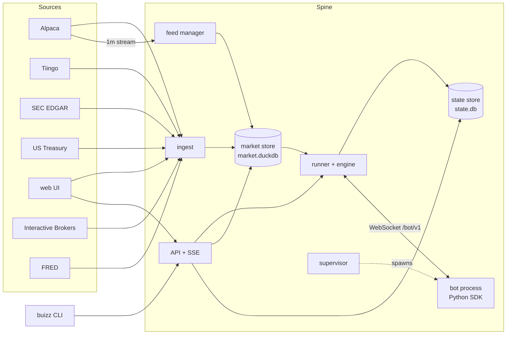

# Architecture

Buizz is one Rust binary, the spine, plus Python bots that dial into it and a web UI the spine serves. The spine owns the clock, order matching, fills and the ledger of every run. Bots only decide.

## Components

| Component | Crate or folder | Job |
|---|---|---|
| Spine | `crates/spine` | The binary: reads the environment, wires everything, serves HTTP, shuts down cleanly on SIGTERM or Ctrl-C (closing event streams, then stopping runs at their last checkpoint); a second signal exits at once. `buizz-spine restore <backup>` loads a market backup into an empty store instead (see Restoring) |
| Core | `crates/core` | Types and rules shared by all: run config, cost model, risk limits, order and ledger types, visibility rules, bot protocol messages, API types |
| Market store | `crates/market` | Embedded DuckDB (`market.duckdb`): instruments, companies (SIC codes), calendar, daily and 1m bars, corporate actions, fundamentals, earnings releases, index membership, borrow availability, rates, macro series, coverage. All reads a run does are as-of queries here. The schema is versioned in `schema_version`: a fresh file gets `schema.sql`, an older one the numbered migrations in `crates/market/migrations/` it has not seen (version 1 is the first deployed schema, kept in `tests/fixtures/schema_v1.sql`), applied in one transaction on open; a file from a newer spine is refused |
| State store | `crates/state` | SQLite in WAL mode (`state.db`): runs, orders, ledger, equity points, run events, job runs, fetch records, step checkpoints. Opening an older file applies the numbered migrations in `crates/state/migrations/` it has not seen |
| Engine | `crates/engine` | Pure, deterministic order matching and portfolio ledger. Takes a bar cycle and the bot's orders, returns fills, ledger entries, equity points and risk breaches. A drawdown breach cancels the working orders and closes every position at the following opens |
| Runner | `crates/runner` | Drives runs: replays bars in lockstep with the bot, calls the engine, commits each step and its checkpoint to the state store, applies the data gate and holdout rule, recovers runs after a restart |
| Supervisor | `crates/supervisor` | Scans `bots/`, starts one child process per run (own process group, killed as a group), captures its output, restarts a crashed live bot after 1, 2, 4, 8 and 16 s and pauses the run after 5 crashes in 10 minutes, runs backtests in parallel up to the core count |
| Feed manager | `crates/feed` | Holds the Alpaca real-time stream subscriptions for live 1m runs. Ref-counted, capped at 30 symbols, refuses over the cap naming the holders, backfills gaps and the session so far for newly subscribed symbols, and writes bars to the market store |
| Ingest | `crates/ingest` | Scheduled jobs that fill the market store (see below), a lazy 1m backfill for minute backtests, a daily `state.db` snapshot |
| Sources | `crates/sources` | Clients for Alpaca (REST and stream), Tiingo, SEC EDGAR, US Treasury, FRED, Wikipedia, NASDAQ Trader's symbol directory and the Interactive Brokers short stock file, with rate limits and backoff |
| API | `crates/api` | Axum routes under `/api` for bots, runs, leaderboard (each bot's latest completed backtest of the period, run with the default costs and the bot's own params and risk limits; runs with overrides do not rank) and data health, server-sent events for live updates (a live run's equity on every step, a backtest's at most every 250 ms plus its final value), the bot WebSocket at `/bot/v1` (peers on loopback or the spine's bound address only), an unauthenticated `GET /healthz` (204) for probes, and the web bundle when `BUIZZ_WEB_DIR` is set; unknown `/api` paths answer a JSON 404. One admin password, an HttpOnly session cookie, failed logins rate-limited per client (an IPv4 address or an IPv6 /64) with a global failure budget that, once spent, paces password checks to one per second, and requests other than reads refused unless a browser sends them from the same origin. Every response carries a same-origin-only Content-Security-Policy that also forbids framing, `nosniff` and a same-origin referrer policy |
| Metrics | `crates/metrics` | CAGR, volatility, Sharpe, Sortino, drawdown, Calmar, win rate, profit factor, exposure, turnover, alpha and beta from the equity series |
| Web | `web/` | React and TypeScript with lightweight-charts: bot grid, bot detail, run view, leaderboard, data health. Types are generated from `openapi.json` |
| SDK | `sdk/python` | The `buizz` package: `Bot`, `Context`, the protocol client and the `buizz` command |
| Bots environment | `bots/pyproject.toml` | The locked Python environment bots run in (SDK, hmmlearn, lightgbm, scikit-learn, scipy) and the shared package `buizz_bots` |

`just gen` regenerates the golden protocol frames in `fixtures/protocol/`, `openapi.json` and `web/src/api/schema.d.ts` from the Rust types; `just drift` (part of `just check`) fails when they differ.

## One event path

The engine only ever reads the market store. Ingest and the feed manager write bars and advance a watermark; a run replays bars up to what the store holds. A backtest is a replay that finds all its bars already there. A live run is the same replay loop blocked at the watermark: it waits until the next bar arrives and then goes on. There is no separate live code path for decisions, so backtest and live behave the same by construction, and recovering after a restart is resuming from the last checkpoint.

For each bar the runner runs one cycle: order expiry, corporate actions, fills (the opening auction at the session's first bar, then market, limit and stop orders at the bar's open or where the bar touches them, then the closing auction at the session's last bar, both at the official prices of the session's daily bar), then at the bar's visible time mark to market, borrow and financing charges at the session close, risk limits, wake the bot, accept its orders. A bar's cycle finishes before the next bar's begins. A session's corporate actions, universe, average daily volumes and financing rate are read when the run enters it: a backtest reads the next session's ahead while it replays the current one, a live run only when it processes the session's first bar, so nothing announced or ingested after it went live is missed. A daily run that wakes before the close gets one more point per session at that time: expiry and corporate actions, a mark at the minute bars so far, the bot's step; the session is then matched in its cycle at the close. Each step is committed together with the engine checkpoint, and so is every bar a live run processes between wakes; the bars and events still waiting for the bot's next step are saved with the checkpoint, so after a restart the clock and equity are where they were and the next step still delivers them.

Live runs on 1m bars use the real-time IEX stream; backtests use SIP history, so volume is partial live. A live 1m run leases stream slots for its session's universe plus the symbols it holds or has orders in, again at every new session and after every step; going live or resuming is refused when the slots are not free, a paused run holds none, and an order for a symbol no free slot can cover is rejected with `no_stream_slot`. Live fills are tagged with the feed. The volume cap uses the average daily volume, so it is the same in both modes. Live runs on daily bars use the official daily bar and take no stream slot, unless they wake before the close: those lease slots like a 1m run for the minute bars of their decision point.
When bars arrive in live while the bot is still deciding, they coalesce into its next step. Pausing a live run cancels its working orders and stops the bot process while the spine keeps marking equity; resuming starts the bot again with its saved state and current holdings and never replays the paused interval.

## Guarantees

**No lookahead.** Every query a bot makes is answered by the spine as of the run clock; the bot has no direct access to data. The visibility rules live in `crates/core` and are the single source of truth: a 1m bar is visible at its start plus 60 seconds, a daily bar at the session close, a fundamental fact at the open of the first session after its SEC `filed` date, a corporate action at the open of its ex-date session, a calendar change at the open of the first session after its announcement. History adjustment uses only corporate actions already visible at the clock. An order decided on bar N cannot fill before bar N+1's open. `fixtures/scenarios/` holds hand-computed expectations, including a lookahead probe.

**Determinism.** The engine uses no wall clock and no unseeded randomness, keeps ordered maps and chains a blake3 hash over every ledger entry and order change. A completed run stores it as `result_hash`: the same bot, config, seed and data give the same hash. Money is `rust_decimal` in the ledger and strings on the wire. Every cash amount enters the ledger rounded half-even to exactly 2 decimals and every price to exactly 4, so `100000` and `100000.00` start cash give the same hash, and a start cash with more than 2 decimals is refused; bars reach bots as float columns, and floats never enter the ledger. All times are UTC.

**Crash safety.** The ledger and checkpoints are written in SQLite transactions, one per step. On start the runner recovers runs that were active.

**Reproducibility.** A run records the bot content hash, engine version, seed, data watermark and its full config. The engine version is a number bumped whenever the engine's behaviour or checkpoint changes. A live run resumes from an older engine's checkpoint; a backtest refuses to, so its result never mixes two engines. A run never continues under different bot code: whenever the runner or the supervisor starts the bot process, a crashed live bot's restart included, the folder's hash is compared with the run's, failing a backtest and pausing a live run with the reason.

## Data sources and limits

| Source | Used for | Limits |
|---|---|---|
| Alpaca (free plan) | Daily and 1m history since 2016, calendar, assets, corporate actions, real-time IEX minute bars | 200 calls per minute, used at most 140 (shared by ingest and the feed manager's backfills); history is delayed by the latest 15 minutes; the stream is capped at 30 symbols; minute bars include extended hours and are filtered to the session |
| Tiingo | Daily history before 2016 | 50 requests an hour, 1000 a day and 500 symbols a month on the free plan, used at most 35, 700 and 350 so a key shared with another project keeps headroom. Its data is only used when it agrees with Alpaca over their overlap; raw closes and split and dividend factors, never adjusted close |
| SEC EDGAR | Point-in-time fundamentals (raw XBRL facts plus canonical metrics), the fund ticker list, SIC codes and earnings releases from company submissions | 10 requests per second, used at most 5; contact User-Agent required (`SEC_USER_AGENT`) |
| US Treasury | Risk-free rate for Sharpe, `treasury_3m` for bots | |
| FRED | Macro series for bots, every ALFRED vintage | 120 requests per minute, used at most 80; free API key (`FRED_API_KEY`) |
| Wikipedia | S&P 500 membership history, rebuilt from *List of S&P 500 companies* and *Historical components of the S&P 500* through the MediaWiki API | One request per second with a User-Agent naming the `SEC_USER_AGENT` contact, as Wikimedia's policy asks; configured with SEC EDGAR. Text under CC BY-SA 4.0 |
| NASDAQ Trader | Which listed symbols are ETFs | The public symbol directory `nasdaqtraded.txt`, one download a day |
| Interactive Brokers | Short availability per US ticker (borrow fee, rebate, shares available), recorded so that point-in-time borrow history accumulates. Not used by runs yet | The public, unauthenticated file `usa.txt` on `ftp2.interactivebrokers.com` (user `shortstock`, no password), as IBKR's knowledge base describes it; one download a day |

Ingest jobs, with their interval: `calendar` 1d, `instruments` 1d, `index_membership` 1d, `bars_1d` 6h, `corporate_actions` 1d, `sec_index` 6h, `fundamentals` 6h, `filings` 6h, `rates` 1d, `borrow` 1d, `macro` 1d, `state_snapshot` 1d, `market_snapshot` 1d, `tiingo_history` 1h. They run in that order, so a first start fills the calendar and instruments, then prices, then fundamentals. A tick every minute starts those that are due, all scheduled from the tick's time so a slow job does not shift the others; one that stopped at its per-run cap with work left (`partial`) runs again on the next tick, one that found nothing new waits its interval, one `waiting` for data its source has not published yet (the day's SEC index, a newer short stock file, the last session's Treasury rate, or the calendar and instruments the price jobs need) retries within the hour, and one that failed, or that a previous start of the spine left unfinished (killed, out of memory), retries after 5 minutes, doubling with each further failure up to its interval, so a job that crashes the process does not crash-loop it. Every client spaces its requests to its budget and retries a whole request three times (0.5, 1 and 2 s apart) on a timeout, a connection dropped before or while the body arrives, or a 5xx. A rate limit (HTTP 429) whose `Retry-After` or `X-RateLimit-Reset` is at most a minute away is waited out and retried; a longer one, or the source's cool-down when it names none (Alpaca, FRED, Wikipedia and Treasury 1 minute, SEC EDGAR 10 minutes, Tiingo 1 hour), pauses that source's jobs until then, and they are due again the moment it ends. SEC EDGAR answers throttling and a missing User-Agent with 403, so a 403 from it counts as a rate limit too. Other failures are reported as failures. Each job shows in the UI's data health page with its last outcome and whether it is stale. `bars_1d` targets the last session closed more than 30 minutes ago (the 15 minute SIP delay plus a settle margin), fetches each symbol from its own last stored session grouped by that date, up to 1000 symbols per request, storing every 10,000-bar page as it arrives (at most 600 requests per run), and re-requests a session until a day after its close, so late corrections and the final consolidated volumes land and a revision afterwards is a genuine correction. It prices every instrument not traded over the counter, active or not, plus every symbol that was ever an S&P 500 member (Alpaca keeps bars for delisted names it no longer lists as assets), in this order: SPY and the core ETFs, current members, past members, other active symbols, the rest. An active symbol more than 20 sessions behind, or one Alpaca has no bars for, is retried weekly instead; an inactive one is fetched once. The daily watermark advances once the symbols that are current have their target session, whatever happened to the lagging ones. A request Alpaca refuses as invalid (400 or 422) or whose answer does not decode (a malformed bar) is split in halves until the symbol behind it is found; that symbol is recorded as rejected and skipped for 30 days, and the rest of its request is stored. Minute backfills are stored page by page too, holding back each page's last symbol-day until the next page completes it. `corporate_actions` backfills each priced symbol from the history start once, 100 symbols per request (at most 40 per run), each stored as it arrives and recorded as Alpaca corporate-action coverage, then refreshes the last 90 days with one market-wide request of a few pages. Both also store actions already announced with an ex-date up to 90 days ahead (runs see an action at its ex-date open, as for history; its batch time records when the store first knew it), and an action Alpaca no longer lists in the requested window is withdrawn to the revision table. `tiingo_history` extends daily history back to the store's start, 2000-01-01, for each symbol whose Alpaca history begins where Alpaca's does (so it was listed before 2016), in the priced order above, one request per symbol covering its whole gap. A symbol Tiingo does not know (404) or whose overlap check fails is listed on the data health page and asked again only after a year, once no untried symbol is left. Jobs run one at a time, so it takes at most 3 symbols per run (its budget of 35 requests an hour spaces them 103 seconds apart) and at most 350 symbols in 30 days: SPY, the core ETFs and the current S&P 500 members are extended within the first two months, every member within about four. `instruments` classes a symbol as a fund (`etf`) when it is on the SEC's mutual fund and ETF ticker list or flagged as an ETF in NASDAQ Trader's symbol directory (which also covers the trusts the SEC list misses, such as SPY and GLD), since Alpaca has no fund flag; funds get no fundamentals. When a list cannot be read, every instrument keeps its stored class; without either list every instrument is a stock. `calendar` reads its whole history once, then only the last 30 days and the year ahead. `sec_index` reads SEC EDGAR's daily index of every filing, one file per weekday since the last one read (SEC publishes none on its holidays, so a day without a file is passed over once a later day's file is read, or once it is three days old), and keeps each 10-K, 10-Q, 20-F, 40-F, their amendments and each 8-K in `sec_filing`. `fundamentals` reads a stock's company facts once, then again only when the index shows a new periodic report filed since the last read, or after 90 days; `filings` does the same for its submissions on a new 8-K: its SIC code and every 8-K with Item 2.02 since the history start (the first read also walks the older filing pages). Both take 500 companies per run, current S&P 500 members first. `macro` asks FRED for new vintage dates since the last vintage it stored and refetches a series only when there is one. `index_membership` rebuilds S&P 500 membership daily and replaces it when Wikipedia changed, keeping the version it replaced; every member it names is priced, so delisted members keep their prices where Alpaca still has them. `borrow` stores the short stock file when it holds a newer snapshot than the last one stored; `just dev` runs with ingest off, so only a deployed spine records it. The `state_snapshot` job writes `state-YYYY-MM-DD.db` and keeps the last 14; `market_snapshot` backs up what the sources cannot give again incrementally: each run that finds new ingest batches writes `market/<first>-<last>/`, Parquet files with the rows of the append-only tables (the ingest batches, the borrow history, every revision table) that those batches added, plus index membership when it changed. The parts together hold each of those rows exactly once, so the backup grows only as fast as that data and no part is ever pruned; the first part replaces the full daily copies (`market-YYYY-MM-DD/`) older spines wrote. Both jobs first remove whatever `*.partial` an interrupted run left. On SIGTERM the spine lets the running ingest request finish and store (up to 20 seconds), stops runs at their last checkpoint and checkpoints the market store. A source without its key or contact is simply not configured, and its jobs report that.

Nothing the store learned is ever overwritten. Every write is an `ingest_batch` with its time; a row that a later batch changes or removes (instruments, calendar sessions, daily bars, corporate actions, rates, macro vintages, companies, earnings releases, index membership) moves to its `<table>_revision` table with `superseded_by` naming that batch, so what was known when can be rebuilt without a re-ingest. A write that changes nothing writes nothing. Fundamental facts, earnings releases and borrow snapshots are append-only; minute bars are a lazily fetched cache of SIP history and are replaced in place.

Minute bars are fetched lazily: a 1m backtest first backfills the gaps in its symbols and period, then runs; a symbol that joins its universe later, or that it starts to trade, is backfilled from that session through the end of the period when it first appears, and the run fails if gaps remain. A minute day counts as covered only when it has SIP bars fetched after the session close plus the SIP delay, so days that hold only live IEX bars or a fetch from inside the session are fetched again. Backtests are refused when daily coverage has gaps. Sessions before a symbol's listing, its `first_session` or else its first daily bar, are not gaps, unless that first bar is the first session of the store's history (2000) or of Alpaca's (2016): there the history stops, not the listing, so earlier sessions are gaps. A refused backtest names its gaps and the date after which a period has none.

## Where state lives

All under `BUIZZ_DATA_DIR` (default `data/`) unless noted.

| Path | Content | Rebuildable |
|---|---|---|
| `market.duckdb` | Market data | Mostly, by ingesting again (about a day for prices, fundamentals and filings; Tiingo's pre-2016 history takes months at 350 symbols a month). The borrow history and the revisions cannot be fetched again: they are in `backups/market/` |
| `market.duckdb.tmp/` | Where the market store spills queries larger than `BUIZZ_DUCKDB_MEMORY` | Scratch |
| `state.db` | Runs, orders, ledger, equity, events, job history, fetch budget | No: this is the backup target |
| `backups/state-YYYY-MM-DD.db` | Daily snapshots of `state.db` | |
| `backups/market/<first>-<last>/` | Incremental Parquet backup of the market tables no source can give again, one part per batch-id range | |
| `logs/<run_id>.log` | Bot process output, one file per run | |

Bots are read from `BUIZZ_BOTS_DIR`. The daily watermark is stored in `market.duckdb` whenever it advances and read back on start; the minute watermark is held in memory and re-advanced by the feed manager.

Restoring, with the spine stopped (on the cluster: scale the Deployment to 0 and run the same image once with the `buizz-data` volume mounted):

1. To bring back run history, copy a `backups/state-YYYY-MM-DD.db` over `state.db`, removing `state.db-wal` and `state.db-shm` first.
2. If `market.duckdb` is lost or damaged, move it aside and run `buizz-spine restore <backup>` with `BUIZZ_DATA_DIR` set, where `<backup>` is `backups/market` (or a `market-YYYY-MM-DD` full copy from an older spine). It creates an empty market store, loads every part in order, takes index membership from the latest part that has it (replacing, not appending), moves the `ingest_batch_id` sequence past the highest restored batch, and records the reset in `state.db`. It refuses a store that already holds an ingest batch, so it must run before ingest has started.
3. Start the spine. The state store's job runs and successful fetches from before the reset no longer describe the market store, so every job is due at once and ingest fetches everything else again (rejections and the fetch budgets still count). A spine that starts with a new, empty market store and an older `state.db` records the same reset on its own.

Both stores open older files and migrate them forward, and refuse a file a newer spine wrote.

## Running on the cluster

Sizes measured for the free-tier universe (about 13,200 active and 2,900 delisted listings, not counting OTC): daily bars since 2016 are about 25 million rows and Tiingo's 2000–2015 history adds up to 20 million; fundamental facts about 20 million rows; the borrow file about 4 million rows a year. That is 3 to 5 GB of `market.duckdb` after the first year, and minute bars, fetched only for minute backtests, add about 2.5 MB per symbol-year. A 50 GiB Longhorn volume leaves room for minute history of a few hundred symbols, the 14 `state.db` snapshots, the market backup and DuckDB's spill directory; grow it before minute backtests over hundreds of symbols and many years.

The spine itself needs little; DuckDB is held to `BUIZZ_DUCKDB_MEMORY` (default 1 GB) and `BUIZZ_DUCKDB_THREADS` (default 2) and spills beyond it, and each running bot is a Python process of 100–400 MB. Requests of 1 CPU and 2 GiB with a 4 GiB memory limit fit ingest plus a few parallel backtests; backtests run in parallel up to the CPUs the pod sees, so give it a CPU limit (for example 4) to keep them within memory.
