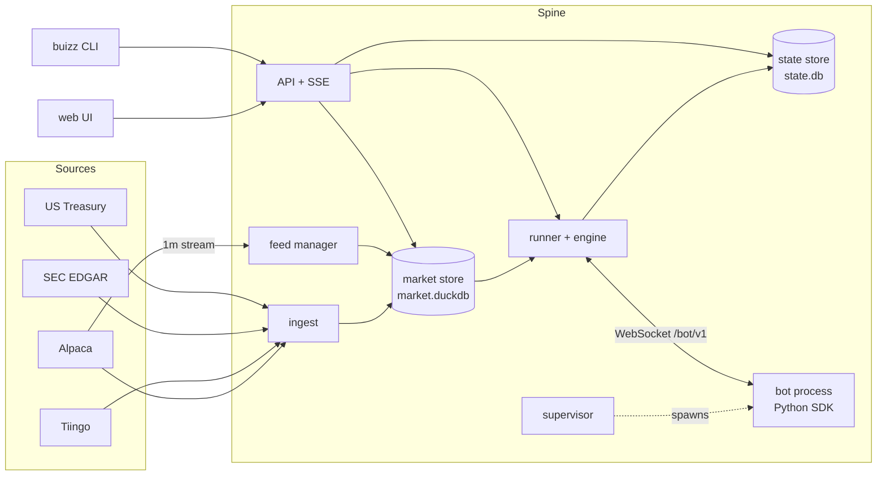

# Architecture

Buizz is one Rust binary, the spine, plus Python bots that dial into it and a web UI the spine serves. The spine owns the clock, order matching, fills and the ledger of every run. Bots only decide.

## Components

| Component | Crate or folder | Job |
|---|---|---|
| Spine | `crates/spine` | The binary: reads the environment, wires everything, serves HTTP, shuts down cleanly |
| Core | `crates/core` | Types and rules shared by all: run config, cost model, risk limits, order and ledger types, visibility rules, bot protocol messages, API types |
| Market store | `crates/market` | Embedded DuckDB (`market.duckdb`): instruments, calendar, daily and 1m bars, corporate actions, fundamentals, rates, coverage. All reads a run does are as-of queries here |
| State store | `crates/state` | SQLite in WAL mode (`state.db`): runs, orders, ledger, equity points, run events, job runs, fetch records, step checkpoints |
| Engine | `crates/engine` | Pure, deterministic order matching and portfolio ledger. Takes a bar cycle and the bot's orders, returns fills, ledger entries, equity points and risk breaches |
| Runner | `crates/runner` | Drives runs: replays bars in lockstep with the bot, calls the engine, commits each step and its checkpoint to the state store, applies the data gate and holdout rule, recovers runs after a restart |
| Supervisor | `crates/supervisor` | Scans `bots/`, starts one child process per run (own process group, killed as a group), captures its output, restarts live bots with backoff, runs backtests in parallel up to the core count |
| Feed manager | `crates/feed` | Holds the Alpaca real-time stream subscriptions for live 1m runs. Ref-counted, capped at 30 symbols, refuses over the cap naming the holders, backfills gaps and writes bars to the market store |
| Ingest | `crates/ingest` | Scheduled jobs that fill the market store (see below), a lazy 1m backfill for minute backtests, a daily `state.db` snapshot |
| Sources | `crates/sources` | Clients for Alpaca (REST and stream), Tiingo, SEC EDGAR and US Treasury with rate limits and backoff |
| API | `crates/api` | Axum routes under `/api` for bots, runs, leaderboard and data health, server-sent events for live updates, the bot WebSocket at `/bot/v1`, and the web bundle when `BUIZZ_WEB_DIR` is set. One admin password, an HttpOnly session cookie, failed logins rate-limited per client |
| Metrics | `crates/metrics` | CAGR, volatility, Sharpe, Sortino, drawdown, Calmar, win rate, profit factor, exposure, turnover, alpha and beta from the equity series |
| Web | `web/` | React and TypeScript with lightweight-charts: bot grid, bot detail, run view, leaderboard, data health. Types are generated from `openapi.json` |
| SDK | `sdk/python` | The `buizz` package: `Bot`, `Context`, the protocol client and the `buizz` command |

`just gen` regenerates the golden protocol frames in `fixtures/protocol/`, `openapi.json` and `web/src/api/schema.d.ts` from the Rust types; `just drift` (part of `just check`) fails when they differ.

## One event path

The engine only ever reads the market store. Ingest and the feed manager write bars and advance a watermark; a run replays bars up to what the store holds. A backtest is a replay that finds all its bars already there. A live run is the same replay loop blocked at the watermark: it waits until the next bar arrives and then goes on. There is no separate live code path for decisions, so backtest and live behave the same by construction, and recovering after a restart is resuming from the last checkpoint.

For each bar the runner runs one cycle: corporate actions, order expiry, fills at the bar's open, then at the bar's visible time mark to market, risk limits, wake the bot, accept its orders. A bar's cycle finishes before the next bar's begins. Each step is committed together with the engine checkpoint.

Live runs on 1m bars use the real-time IEX stream; backtests use SIP history, so volume is partial live. Live fills are tagged with the feed. The volume cap uses the average daily volume, so it is the same in both modes. Live runs on daily bars use the official daily bar and take no stream slot.
When bars arrive in live while the bot is still deciding, they coalesce into its next step. Pausing a live run cancels its working orders and stops the bot process while the spine keeps marking equity; resuming starts the bot again with its saved state and current holdings and never replays the paused interval.

## Guarantees

**No lookahead.** Every query a bot makes is answered by the spine as of the run clock; the bot has no direct access to data. The visibility rules live in `crates/core` and are the single source of truth: a 1m bar is visible at its start plus 60 seconds, a daily bar at the session close, a fundamental fact at the open of the first session after its SEC `filed` date, a corporate action at the open of its ex-date session. History adjustment uses only corporate actions already visible at the clock. An order decided on bar N cannot fill before bar N+1's open. `fixtures/scenarios/` holds hand-computed expectations, including a lookahead probe.

**Determinism.** The engine uses no wall clock and no unseeded randomness, keeps ordered maps and chains a blake3 hash over every ledger entry and order change. A completed run stores it as `result_hash`: the same bot, config, seed and data give the same hash. Money is `rust_decimal` in the ledger and strings on the wire, where the HTTP API writes cash amounts with 2 decimals and prices with 4; bars reach bots as float columns, and floats never enter the ledger. All times are UTC.

**Crash safety.** The ledger and checkpoints are written in SQLite transactions, one per step. On start the runner recovers runs that were active.

**Reproducibility.** A run records the bot content hash, engine version, seed, data watermark and its full config.

## Data sources and limits

| Source | Used for | Limits |
|---|---|---|
| Alpaca (free plan) | Daily and 1m history since 2016, calendar, assets, corporate actions, real-time IEX minute bars | 200 calls per minute; history is delayed by the latest 15 minutes; the stream is capped at 30 symbols; minute bars include extended hours and are filtered to the session |
| Tiingo | Daily history before 2016 | 1000 requests per day and 500 symbols per month on the free plan. Its data is only used when it agrees with Alpaca over their overlap; raw closes and split and dividend factors, never adjusted close |
| SEC EDGAR | Point-in-time fundamentals: raw XBRL facts plus canonical metrics | 10 requests per second, contact User-Agent required (`SEC_USER_AGENT`) |
| US Treasury | Risk-free rate for Sharpe | |

Ingest jobs, with their interval: `calendar` 1d, `instruments` 1d, `bars_1d` 6h, `corporate_actions` 1d, `fundamentals` 6h, `rates` 1d, `state_snapshot` 1d, `tiingo_history` 1h. A tick every minute starts those that are due; one that found nothing to do retries within the hour, and one that failed retries after 5 minutes, doubling with each further failure up to its interval. Only a rate limit (HTTP 429) pauses a source's jobs, until the retry-after it gave or 6 hours; other failures are reported as failures. Each job shows in the UI's data health page with its last outcome and whether it is stale. `bars_1d` targets the last session closed more than 30 minutes ago (the 15 minute SIP delay plus a settle margin), fetches each symbol from its own last stored session grouped by that date, and re-requests the last two sessions every run so late corrections land. A symbol more than 20 sessions behind, or one Alpaca has no bars for, is retried weekly instead. The `state_snapshot` job writes `state-YYYY-MM-DD.db` and keeps the last 14. A source without its key or contact is simply not configured, and its jobs report that.

Minute bars are fetched lazily: a 1m backtest first backfills the gaps in its symbols and period, then runs. Backtests are refused when daily coverage has gaps.

## Where state lives

All under `BUIZZ_DATA_DIR` (default `data/`) unless noted.

| Path | Content | Rebuildable |
|---|---|---|
| `market.duckdb` | Market data | Yes, by ingesting again from the sources |
| `state.db` | Runs, orders, ledger, equity, events, job history, fetch budget | No: this is the backup target |
| `backups/state-YYYY-MM-DD.db` | Daily snapshots of `state.db` | |
| `data/logs/<run_id>.log` | Bot process output, one file per run | Relative to the spine's working directory |

Bots are read from `BUIZZ_BOTS_DIR`. Market data watermarks are held in memory and re-advanced on start from what the store contains.
